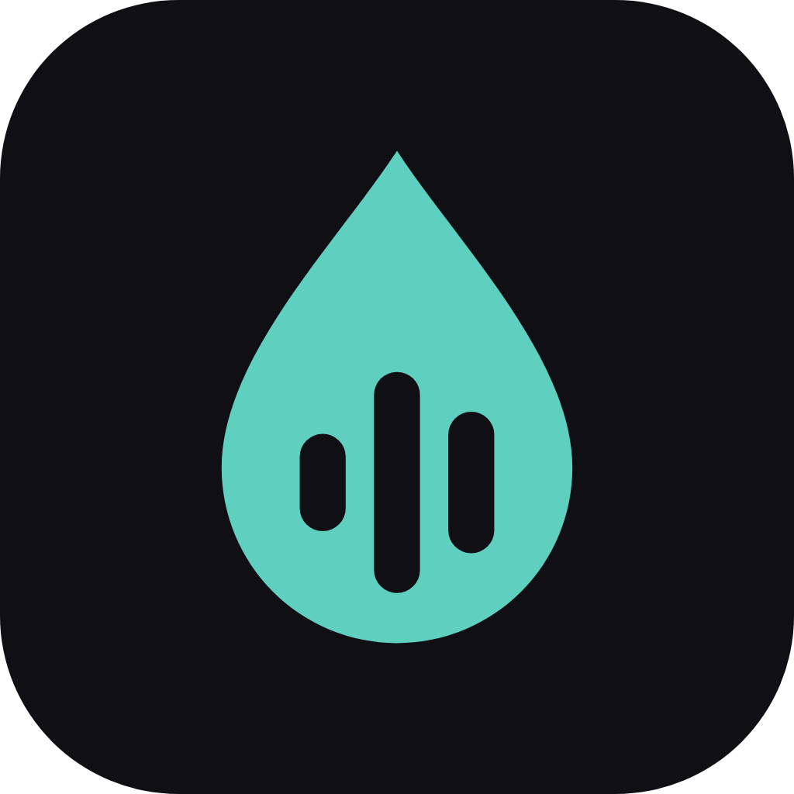

<p align="center">
  
</p>

<h1 align="center">Absorb Plus</h1>

<p align="center">
  A listening app for your own <a href="https://www.audiobookshelf.org/">Audiobookshelf</a> server,<br>
  on <b>Windows, Android, Linux and the web</b>.
</p>

<p align="center">
  <a href="../../releases"></a>
  
  <a href="LICENSE"></a>
</p>

Absorb Plus is an unofficial edition of [Absorb](https://github.com/pounat/absorb), the card-based Audiobookshelf client. It keeps everything Absorb does and brings it to the desktop and the browser, with its own logo and looks, keyboard control and a long list of reliability fixes.

## Download

| Platform | Get it | Notes |
|---|---|---|
| **Windows** (x64) | [Installer or portable ZIP](../../releases) | The installer updates in place and keeps your data. |
| **Android** | [APK](../../releases) | Pick `arm64-v8a` for any recent phone, or `universal` if unsure. Updates install over the previous version. |
| **Linux** (x64) | [`.deb` or `.tar.gz`](../../releases) | Needs libmpv (`libmpv2` on Ubuntu 24.04, `libmpv1` on 22.04). |
| **Web** | [Open in your browser](https://atewertfd.github.io/absorb-platform/) | Nothing to install. Your server must allow requests from this site. |

Releases marked **pre-release** are betas. The app checks for updates and tells you when one is ready; it never installs anything on its own.

## What Plus adds

- **Windows, Linux and web.** The full app runs on the desktop with native audio, a resizable window, and Windows media controls (Linux uses MPRIS).
- **At home on Windows.** Closing the window saves your place and quits, or keeps Absorb Plus in the tray if you turn on *Close to tray*. Also in *Settings › Windows Settings*: start with Windows (optionally minimized), always on top, and keeping the PC awake while playing or downloading. The taskbar button shows playback progress and has rewind, play/pause and fast-forward buttons, <kbd>F11</kbd> switches to full screen, and opening the app again brings back the window that's already running.
- **Choose your look.** Standard (today's look), Frosted (soft frosted-glass panels, in three glass strengths) or Midnight (true black with thin outlines). *Look details* switches bring back touches of the first Windows version. Every choice shows a live preview of the real app, and **Try it** lets you walk around in a look before keeping it. Pick in *Settings › Appearance › UI theme*.
- **Keyboard first on desktop.** Play, seek, speed, search and navigation all have shortcuts (below), and the header controls work with Tab and Enter.
- **Smooth scrolling** with a mouse wheel, without changing how touch scrolling feels.
- **Libation import.** Upload books you exported with [Libation](https://github.com/rmcrackan/Libation) straight to your server (details below).
- **Fewer surprises.** Crash fixes after leaving a screen mid-load; offline listening time that waits for the server instead of being dropped; multi-disc books that download every track; download names that work on Windows; and failures in sync, downloads and sign-in written to the log (without passwords or tokens) so problems can be tracked down.
- **Lighter when idle.** The app no longer redraws non-stop while nothing is happening.
- **Updates from this project.** Settings › *Check for update*, with an optional beta channel.

## Everything from Absorb

The card-based **Absorbing** player, downloads for offline listening, podcasts, multiple accounts and servers, sleep timer with auto-sleep, per-book speed, auto-rewind, bookmarks and notes, chapter navigation, search and filters, playlists and collections, listening stats, an ebook reader with read-along, custom headers for reverse proxies, OpenID sign-in, server admin tools, backup and restore, and community translations.

Some of these are Android-only because they depend on Android itself: Android Auto, Chromecast, home-screen widgets, the equalizer and silence skipping.

## Keyboard shortcuts (desktop)

| Key | Action |
|---|---|
| <kbd>Space</kbd> | Play / pause |
| <kbd>←</kbd> / <kbd>→</kbd> | Rewind / fast-forward |
| <kbd>[</kbd> / <kbd>]</kbd> | Slower / faster |
| <kbd>\\</kbd> | Normal speed |
| <kbd>Ctrl</kbd>+<kbd>F</kbd> | Search |
| <kbd>Ctrl</kbd>+<kbd>L</kbd> | Library |
| <kbd>Ctrl</kbd>+<kbd>N</kbd> | Now playing |
| <kbd>F11</kbd> | Full screen (Windows) |

Shortcuts without <kbd>Ctrl</kbd> only act when you're not typing in a text field.

## Screenshots

<p align="center">
  
  &nbsp;
  
  &nbsp;
  
</p>

## Libation import

If you already have audiobooks exported with Libation, Absorb Plus can upload them to your Audiobookshelf server: *Settings › Advanced › Import Libation exports* (also under *Manage › Upload*).

- Scan your Libation folder (newest first, with **New** and **Imported** tags), or pick a book folder or files directly.
- Check the title and destination, then press **Upload**. Nothing is uploaded without that.
- The app warns when a book is already in your library and tells you when the server has finished indexing it.

Absorb Plus does **not** sign in to Audible, store Audible credentials, remove DRM or download protected content. It only uploads files you already exported. Books are uploaded one at a time; see [import verification](docs/IMPORT-VERIFICATION.md) for details and limits.

## Building from source

You need Flutter stable. On Windows you also need Visual Studio with *Desktop development with C++* and the NuGet CLI; on Linux, the GTK 3, CMake, Ninja, Clang, libmpv and WebKitGTK development packages.

```bash
flutter pub get
flutter build windows --release   # or: linux, web, apk
flutter test
```

Contributors on Windows can use `tool/dev.ps1` (`check`, `build`, `apk`, …). The code map is in [docs/ARCHITECTURE.md](docs/ARCHITECTURE.md) and the house rules are in [AGENTS.md](AGENTS.md).

## Good to know

- **Not official.** Absorb Plus is a separate project from Absorb. Report Windows, Android, Linux and web problems [here](../../issues). For iPhone, iPad, Mac and CarPlay, use upstream [Absorb](https://github.com/pounat/absorb); Absorb Plus doesn't build for Apple platforms.
- **Built with AI.** Most of the code is written by AI (Claude Code) under the direction of a human owner, who decides what ships and tests every build. Every change goes through automated checks, and a throwaway test server is used for integration tests.
- **Your server, your data.** Absorb Plus talks to the Audiobookshelf server you sign in to. Uploads and changes to your server only happen when you ask for them.

## Credits and license

Absorb Plus is built on [Absorb](https://github.com/pounat/absorb) by [pounat](https://github.com/pounat) and its contributors. Like Absorb, it is licensed under the [GNU General Public License v3.0](LICENSE).
